# Extracted figures from executed CSC412 reports

These images are **extracted directly from the uploaded executed notebook PDFs**, not newly generated by rerunning experiments. The source PDF page is recorded for each figure. Some plots are grouped into several individual image objects by the PDF export.

> Note: Figures retain the original image resolution. Some PDF exports embed small raster plots; extraction cannot restore detail absent from the source.

## Part 1

### Expected Loss By Spam Probability
*Source: CSC412 Report Part 1, PDF page 2*

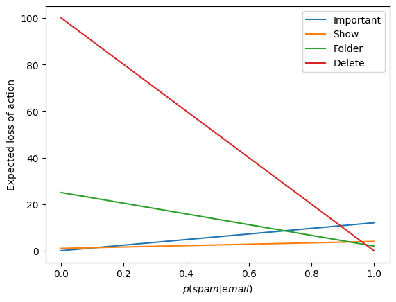

### Optimal Decision Expected Loss
*Source: CSC412 Report Part 1, PDF page 3*

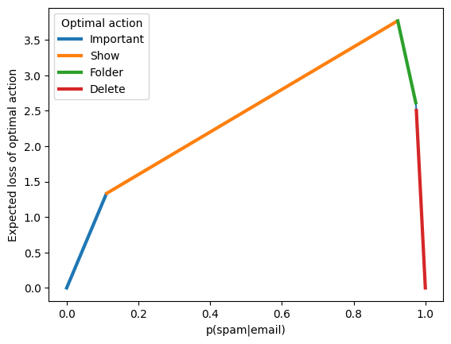

### Fashion Mnist Sample Grid
*Source: CSC412 Report Part 1, PDF page 5*

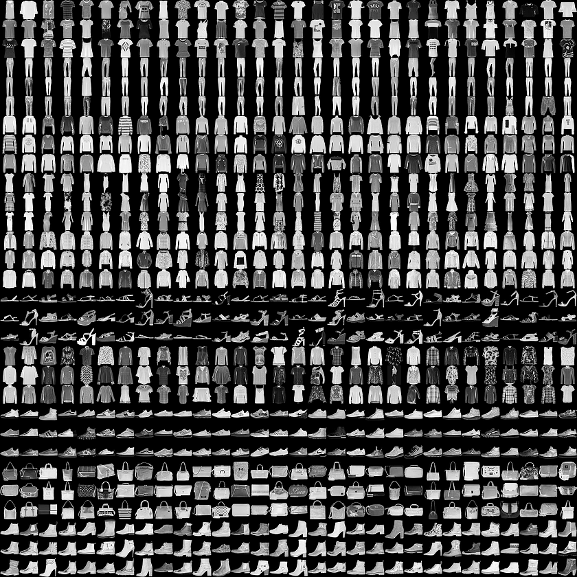

### Naive Bayes Generated Samples
*Source: CSC412 Report Part 1, PDF page 11*

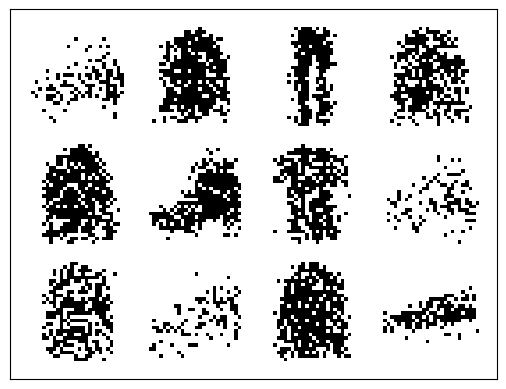

### Missing Pixel Imputation Original
*Source: CSC412 Report Part 1, PDF page 12*

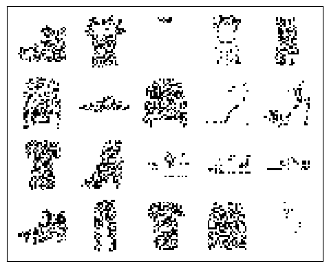

### Missing Pixel Imputation Reconstruction
*Source: CSC412 Report Part 1, PDF page 12*

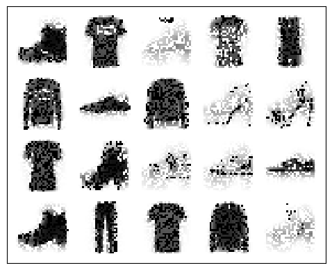

### Bayes Ball Dag
*Source: CSC412 Report Part 1, PDF page 13*

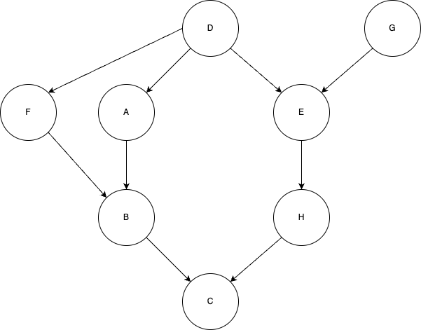

### Graphical Model Conditional Independence
*Source: CSC412 Report Part 1, PDF page 15*

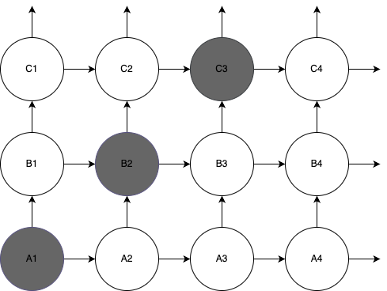

### Bayes Ball Lattice
*Source: CSC412 Report Part 1, PDF page 16*

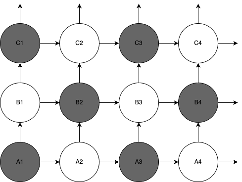

### Bayes Ball Checkerboard
*Source: CSC412 Report Part 1, PDF page 17*

## Part 2

### Laika Original Binary Image
*Source: CSC412 Report Part 2, PDF page 2*

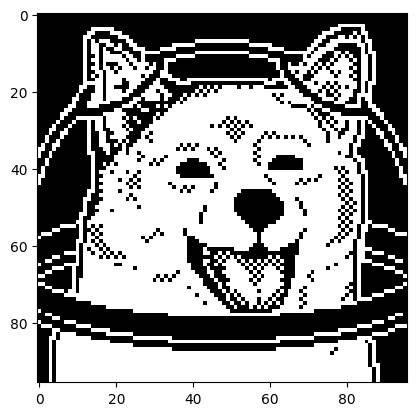

### Laika Noisy Image
*Source: CSC412 Report Part 2, PDF page 3*

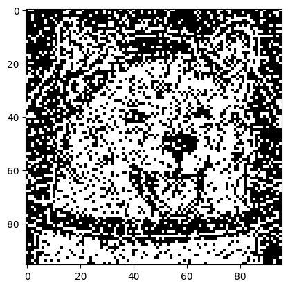

### Loopy Bp Denoising Comparison
*Source: CSC412 Report Part 2, PDF page 6*

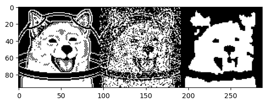

### Loopy Bp Step Size Comparison 1
*Source: CSC412 Report Part 2, PDF page 7*

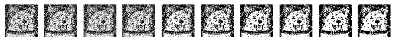

### Loopy Bp Step Size Comparison 2
*Source: CSC412 Report Part 2, PDF page 7*

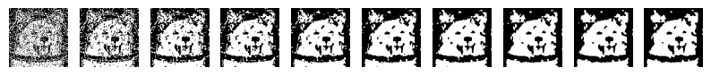

### Loopy Bp Step Size Comparison 3
*Source: CSC412 Report Part 2, PDF page 7*

### Loopy Bp Noise Level Comparison
*Source: CSC412 Report Part 2, PDF page 8*

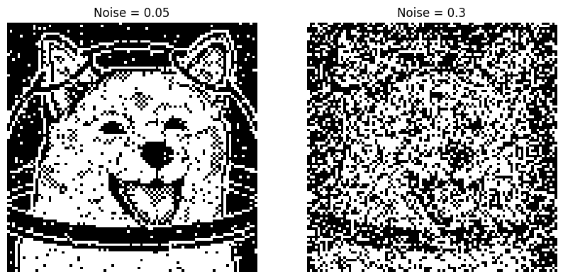

### Loopy Bp Coupling Strength Comparison 1
*Source: CSC412 Report Part 2, PDF page 9*

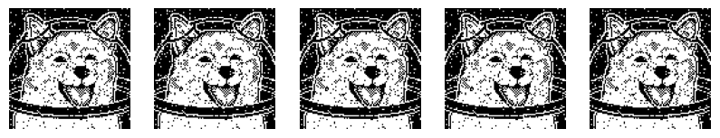

### Loopy Bp Coupling Strength Comparison 2
*Source: CSC412 Report Part 2, PDF page 9*

### Loopy Bp Coupling Strength Comparison 3
*Source: CSC412 Report Part 2, PDF page 9*

### Loopy Bp Coupling Strength Comparison 4
*Source: CSC412 Report Part 2, PDF page 9*

### Loopy Bp Coupling Strength Comparison 5
*Source: CSC412 Report Part 2, PDF page 9*

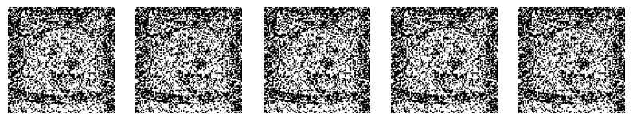

### Loopy Bp Coupling Strength Comparison 6
*Source: CSC412 Report Part 2, PDF page 9*

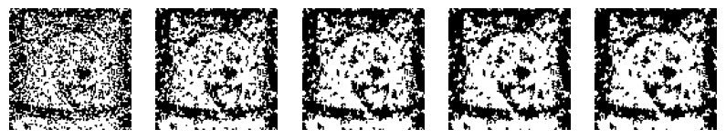

### Loopy Bp Coupling Strength Comparison 7
*Source: CSC412 Report Part 2, PDF page 9*

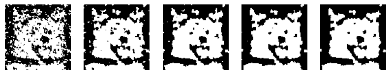

### Loopy Bp Coupling Strength Comparison 8
*Source: CSC412 Report Part 2, PDF page 9*

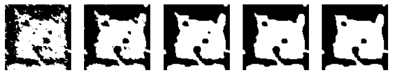

### Trueskill Likelihood Contours 1
*Source: CSC412 Report Part 2, PDF page 12*

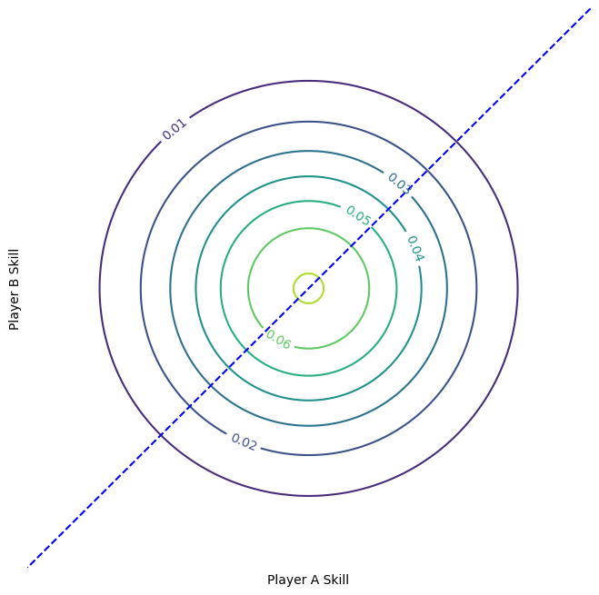

### Trueskill Likelihood Contours 2
*Source: CSC412 Report Part 2, PDF page 12*

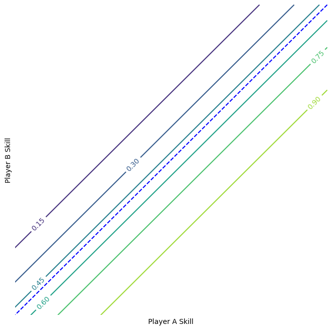

### Trueskill Posterior Contours
*Source: CSC412 Report Part 2, PDF page 13*

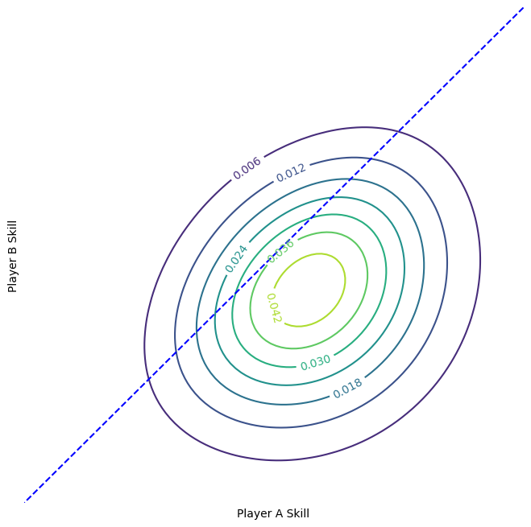

### Trueskill Eight Games Posterior 1
*Source: CSC412 Report Part 2, PDF page 14*

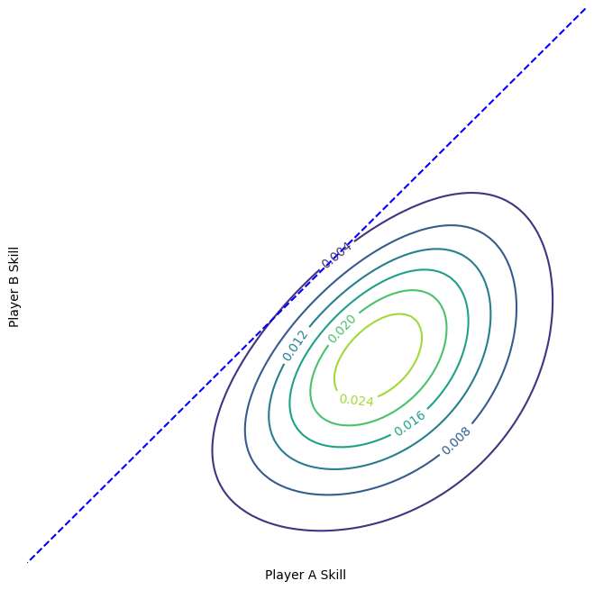

### Trueskill Eight Games Posterior 2
*Source: CSC412 Report Part 2, PDF page 14*

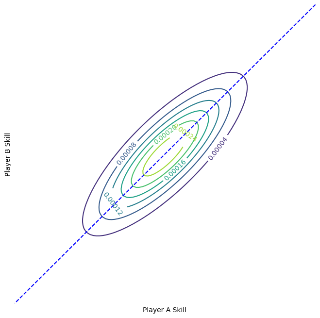

### Hmc Two Player Samples
*Source: CSC412 Report Part 2, PDF page 16*

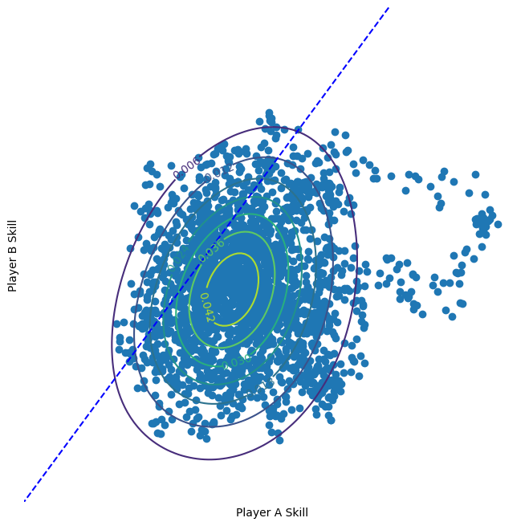

### Hmc Eight Wins Samples
*Source: CSC412 Report Part 2, PDF page 17*

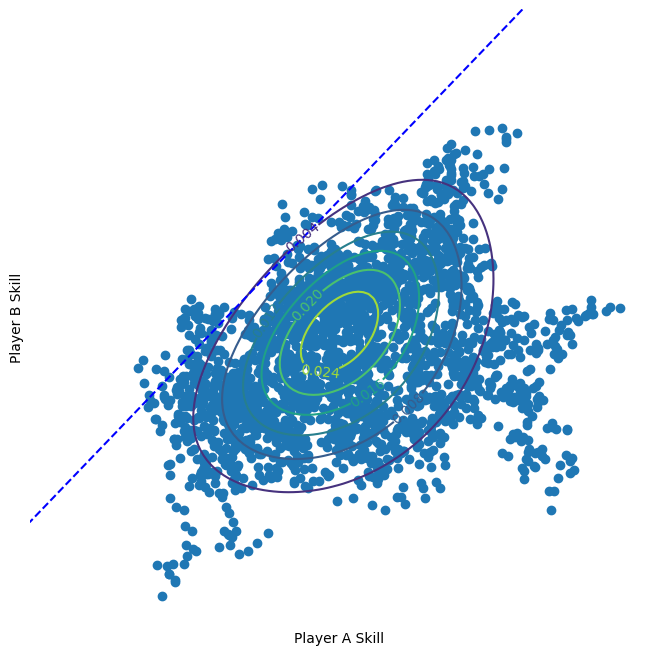

### Hmc Chess Player Skill Samples
*Source: CSC412 Report Part 2, PDF page 18*

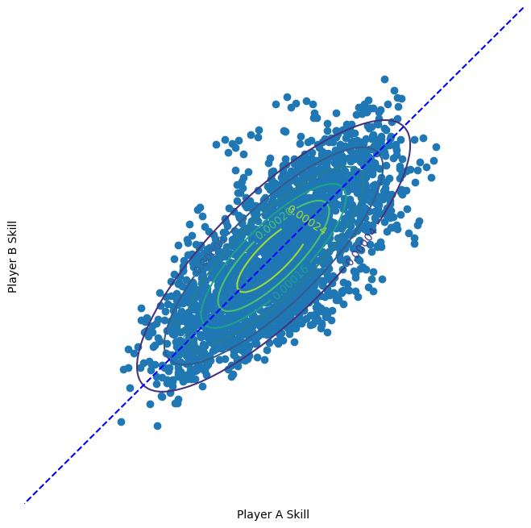

### Chess Player Skill Estimates
*Source: CSC412 Report Part 2, PDF page 20*

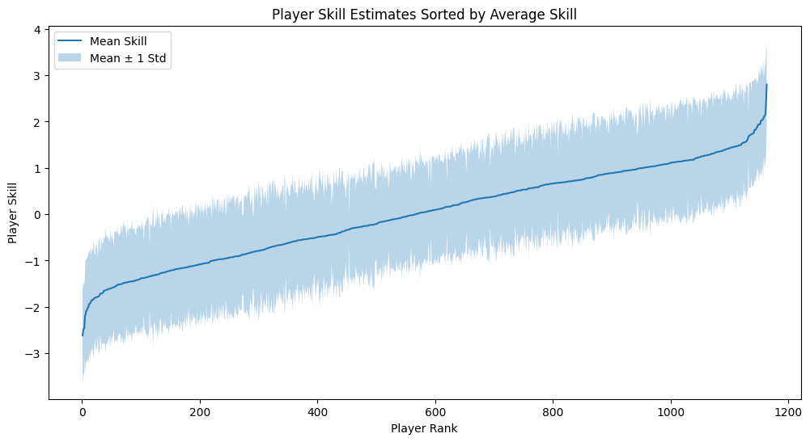

### Chess Skill Pairwise Scatter
*Source: CSC412 Report Part 2, PDF page 22*

### Chess Skill Pairwise Posterior
*Source: CSC412 Report Part 2, PDF page 23*

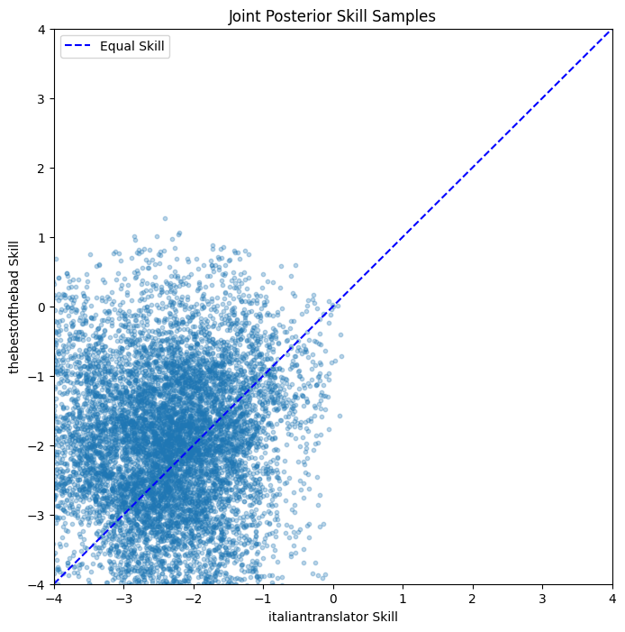

## Part 3

### Svi Two Player Posterior Contours
*Source: CSC412 Report Part 3, PDF page 5*

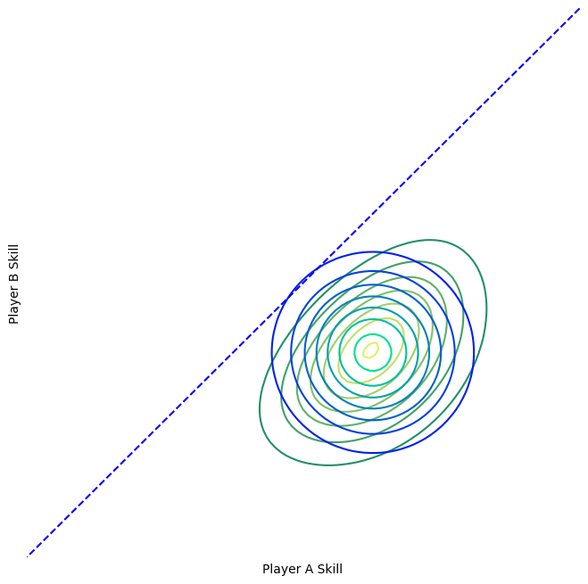

### Svi Chess Player Skill Estimates
*Source: CSC412 Report Part 3, PDF page 8*

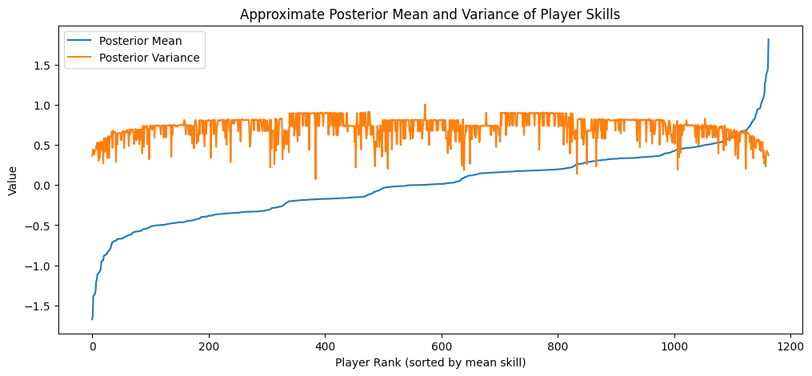

### Svi Chess Skill Pairwise Scatter
*Source: CSC412 Report Part 3, PDF page 9*

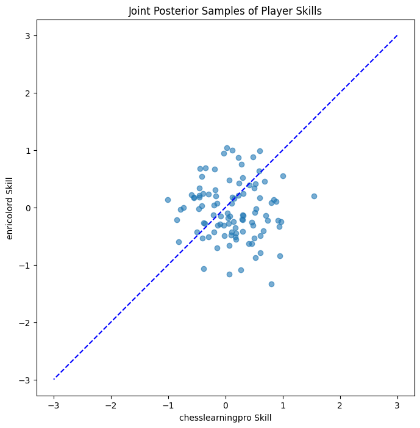

### Pinwheel Dataset
*Source: CSC412 Report Part 3, PDF page 11*

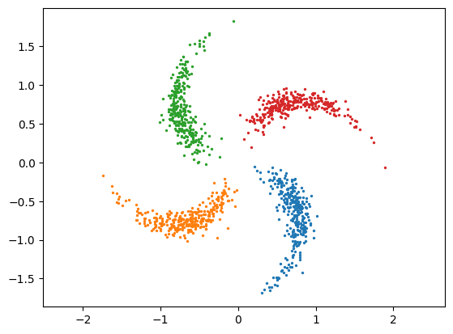

### Vae Latent Space Samples
*Source: CSC412 Report Part 3, PDF page 14*

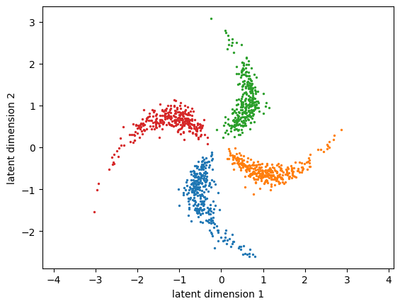

### Vae Decoder Warped Grid
*Source: CSC412 Report Part 3, PDF page 15*

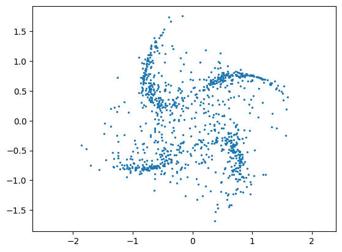

### Vae Encoder Warped Grid 1
*Source: CSC412 Report Part 3, PDF page 16*

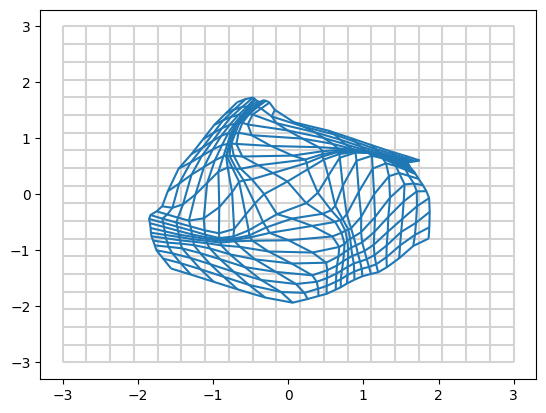

### Vae Encoder Warped Grid 2
*Source: CSC412 Report Part 3, PDF page 16*

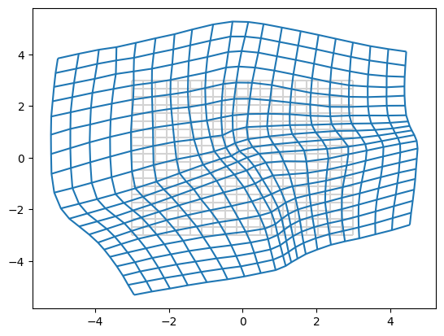

### Kmeans Synthetic Dataset
*Source: CSC412 Report Part 3, PDF page 17*

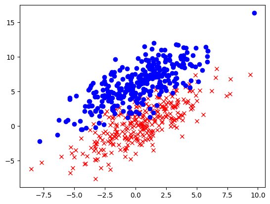

### Kmeans Distortion Curve
*Source: CSC412 Report Part 3, PDF page 19*

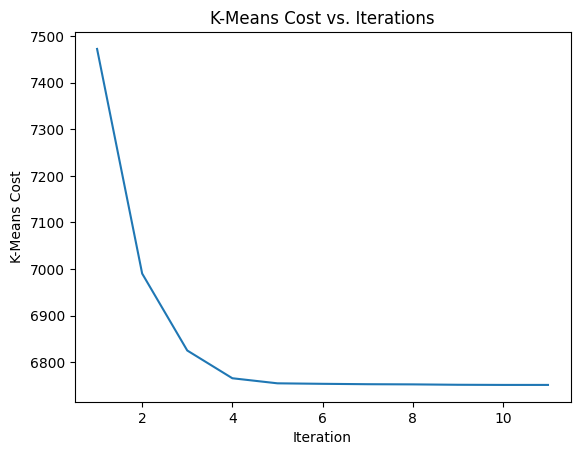

### Kmeans Cluster Assignments
*Source: CSC412 Report Part 3, PDF page 20*

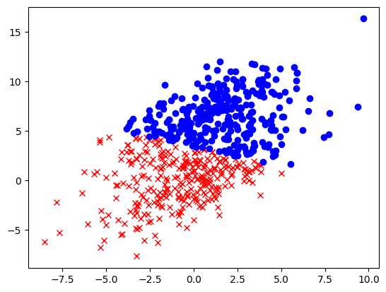

### Gaussian Mixture Em Log Likelihood
*Source: CSC412 Report Part 3, PDF page 22*

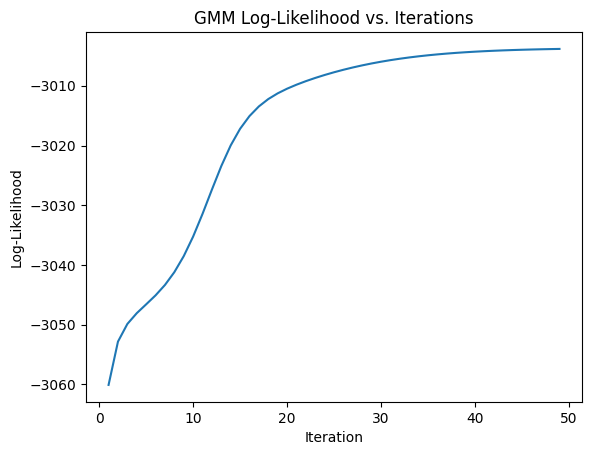
